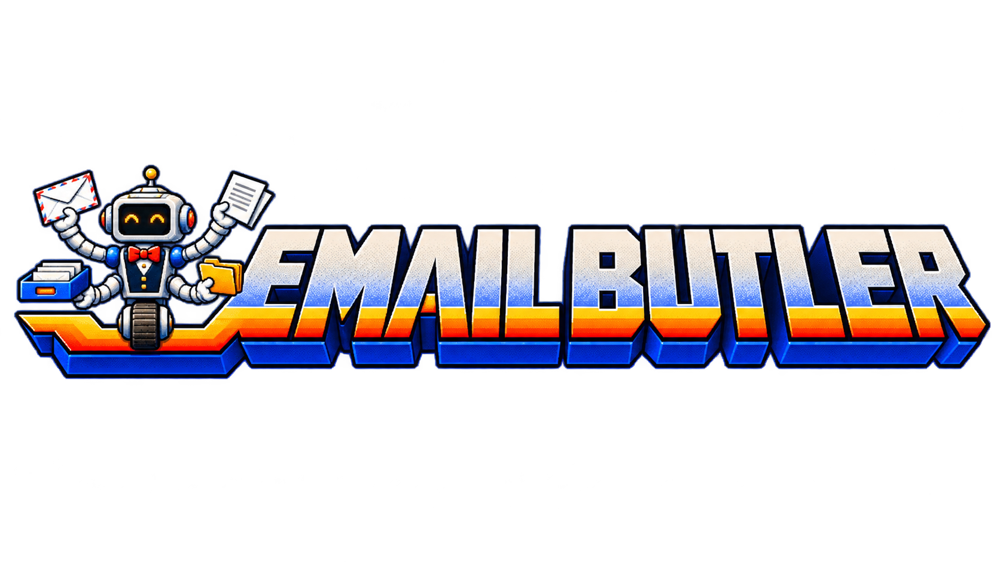

# EmailButler
An email assistant you use by talking to your agent. It helps you review Gmail and Outlook, file recurring mail automatically where supported, and change how it works after showing you a clear preview.

This is an initial prototype. Your agent handles installation, checks your Gmail and Outlook connections, and guides you through any sign-in or permission clicks.

<h2> Start here with your agent</h2>
For first setup, use an agent that can work with files on your computer, such as Codex desktop or Claude Code in the Claude desktop app. Copy the prompt below into that agent. You do not need to use a terminal or edit files.

An ordinary web chat without access to your computer cannot install this local package. Settings saved here are not automatically shared with web chats.

```text
Set up EmailButler from the public repository https://github.com/jcklpe/EmailButler on this computer. Retrieve the repository, read AGENTS.md and skills/setup-emailbutler/SKILL.md, and handle the installation. Install or enable the official Gmail and Outlook/Microsoft 365 connectors for this agent, reusing any correct existing connections. Guide me through sign-in or permission clicks that require me. Check the actual accounts and capabilities available here, create private settings without overwriting existing ones, and start the guided first-run bulk triage, explain the proposed cleanup and complete approved work in bounded connector batches. Ask customization questions after I have something useful to react to. Keep private settings and mail out of Git. Do not ask me to use a terminal or edit code. If an actual restriction prevents a step, explain that specific restriction and what I need to do next.
```

The agent handles the technical steps, including setup, saved preferences, updates, and troubleshooting. You describe what you want and approve the result. Your sign-in, consent, and required approval clicks stay with you. If a work-laptop or app restriction blocks setup, deal with that specific restriction when it occurs.

## Update an existing EmailButler
Already have EmailButler? Copy this prompt into the agent you use with it. This also works as an entrypoint for older installations that do not yet have an update skill.

```text
Update my existing EmailButler to the newest published version from https://github.com/jcklpe/EmailButler. Locate the installation this agent actually uses, including an older email-butler installation. Retrieve the current upstream instructions in an isolated candidate and follow its AGENTS.md and skills/update-emailbutler/SKILL.md, even if my installed version has no update skill.

Preserve my private settings, history, saved progress, local customizations and existing mail connections. Inspect local changes before updating, prepare a checked candidate with a recovery point, and explain the relevant changes and any compatibility decision. Handle any necessary skill-registration migration through the update workflow.

Apply the approved update, verify the package and registrations, and check that this agent can discover the updated skills. Explain any required reload or new-chat step and distinguish saved files from verified active behavior. Handle the technical work for me without asking me to use a terminal or edit code. Keep this update scoped to package files and registrations.
```

## Everyday use
- “Review my email.”
- “Show me what needs a decision.”
- “Help organize recurring messages.”
- “Change my email butler: make the reviews shorter.”
- “Update EmailButler.”

To change how it works from now on, start with **“change my email butler.”** It will explain what would change and ask “Apply this change?” You can reply “Yes, please” or choose a displayed alternative by saying “the second one.” Other feedback helps with the review you are doing now. You can also ask what changed before, or ask to go back to earlier settings.

Automatic mail rules handle predictable future messages after approval. The butler reviews exceptions and messages needing judgment. Creating a rule for future mail and cleaning up existing mail are separate actions.

## A manageable review
You get 15 emails at a time in text and two or three in voice, with the most important decisions first. Each email has its own heading, linked sender/subject, short explanation, bold arrow recommendation, visible unsubscribe line, and separator. The unsubscribe line links directly to the sender’s actual option and explains its type and likely relevance when available. You can approve individual items, change a recommendation, pause, or ask for the next batch. [Example review](skills/review-inbox-emailbutler/references/review-format.md#chat-layout).

First-time setup starts a [guided bulk triage](skills/bulk-triage-emailbutler/SKILL.md): inspect a few real groups, propose useful folders/labels, and file approved groups before settling into regular reviews. Stars and flags stay with the mail; they guide the proposed destination rather than automatically keeping it in Inbox. You can override any recommendation. Inbox is for current incoming mail, with reviewed work and reference material filed into specific homes.

Setup records whether initial cleanup was completed, deliberately deferred or blocked. An approved cleanup continues automatically across connector batches within its stated scope and stopping conditions. You can pause it. Later reviews keep up with current mail while unfinished historical work has its own checkpoint. The agent uses mailbox searches and native rules for repetitive cleanup instead of reading thousands of messages into a chat. Nothing is bulk archived just because it is old. [Backlog approach](skills/bulk-triage-emailbutler/SKILL.md).

## Remembering and reducing the load
When your agent can save settings, EmailButler remembers your preferences, review progress, confirmed mail actions, and clear feedback about recurring messages. You can ask “What do you remember?” or “What changed?” Your history stays private. You can also ask to undo a settings change, return filed mail to Inbox, forget specific feedback, or change the review format. The agent looks up what is needed and explains any choice or limit; you do not manage files or code.

The agent checks patterns after completed slates and proactively raises at most one worthwhile rule/subscription suggestion per session. You do not need to ask it to look. Repeatedly archiving a newsletter can prompt “Keep receiving this, unsubscribe, or file it automatically?” The agent checks examples and exceptions with you before setting up a narrow filter or rule. It suggests unsubscribing from unwanted subscriptions and handles it through a supported connection when available, or shows the legitimate sender's unsubscribe link. It never treats silence as consent or changes your rules just because it noticed a pattern. Useful mail can still benefit from specific filing; useful feedback prevents an automatic unsubscribe suggestion, not a filing discussion. Planner and cloud-document integrations are outside this release.

## Current limits
What EmailButler can do depends on your current app and mail connections. Your agent checks them and explains any limit when it affects your request, along with the next useful step.

Saved preferences on one computer are not automatically shared with web chats. If your current chat cannot remember a change for next time, it will say so. Signing in or granting account access may still require your own clicks.

<details>
<summary>Technical setup and maintenance notes — for agents</summary>

## Package contents
The repository is a skill collection described by [docs/emailbutler.json](docs/emailbutler.json), EmailButler's own version/membership record consumed by its installer and validator. It is not a host-specific package format. [Setup](skills/setup-emailbutler/SKILL.md), [Bulk Triage](skills/bulk-triage-emailbutler/SKILL.md), [Review Inbox](skills/review-inbox-emailbutler/SKILL.md), [Customize](skills/customize-emailbutler/SKILL.md) and [Update](skills/update-emailbutler/SKILL.md) each own their workflow, supporting scripts and tests. Customize owns the [default profile](skills/customize-emailbutler/assets/default-profile.json). Setup owns shared registration, package validation and private-storage mechanics; other skills call those implementations through the complete checkout. Keep the collection together when installing/updating. No separate toolkit or personal workspace is required. Documentation artwork lives under docs/assets; the setup marker reuses the Agent Hands robot artwork.

For maintainers, Python 3.11+ is sufficient; runtime and tests use the standard library. Run `python3 -B skills/setup-emailbutler/scripts/run_tests.py`, or add `--skill review-inbox-emailbutler` for one workflow. Every test suite lives in its owning skill; Update owns existing-registration migration tests. Setup registers fresh/correct collections and hands required migration to Update, which requests explicit migration mode after preparing the approved change. Conflicts remain intact. Offline tests do not establish recipient discovery, sign-in, permissions or mailbox behavior.

Recipient-facing procedures and relevant private-state contracts live in the focused skills. See [Setup](skills/setup-emailbutler/SKILL.md), [capability evidence](skills/setup-emailbutler/references/capabilities.md) and [Update/migration](skills/update-emailbutler/SKILL.md). Local private state is supported; a shared cloud/local persistence adapter is not shipped.

</details>
